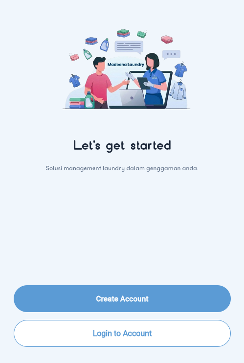
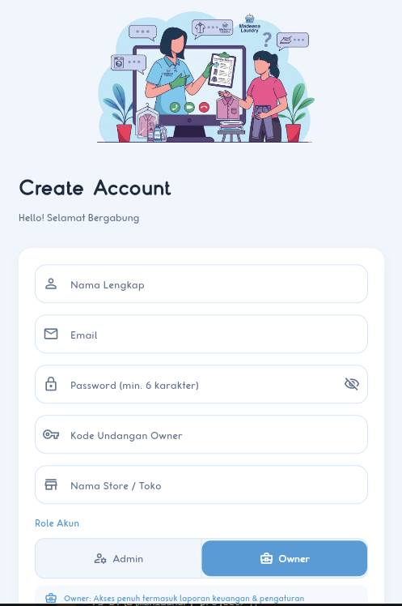
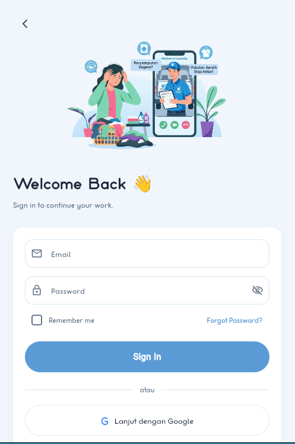
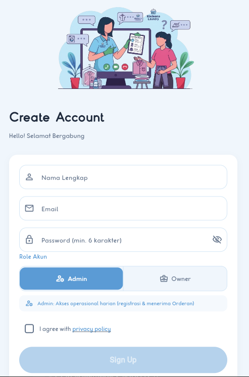
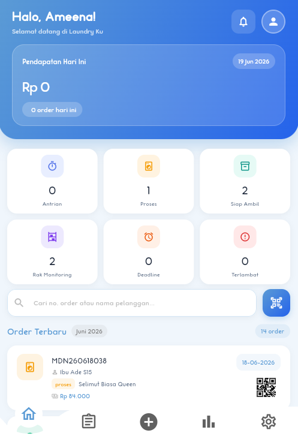
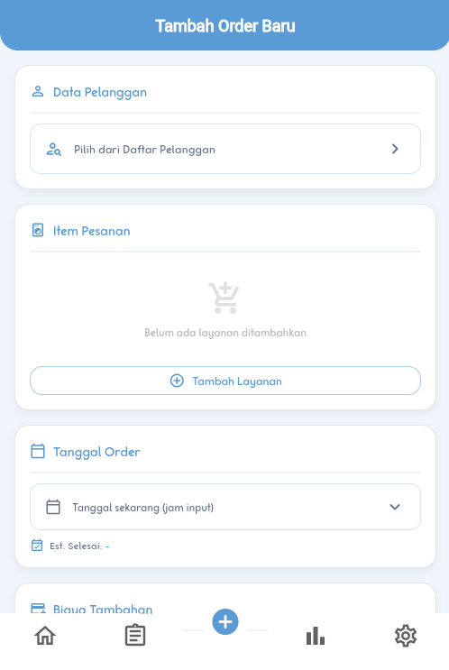
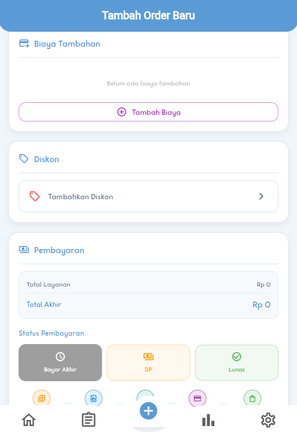
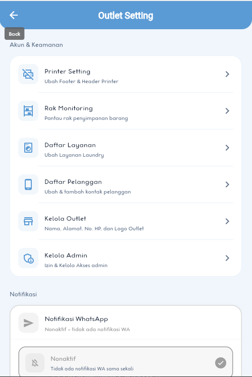
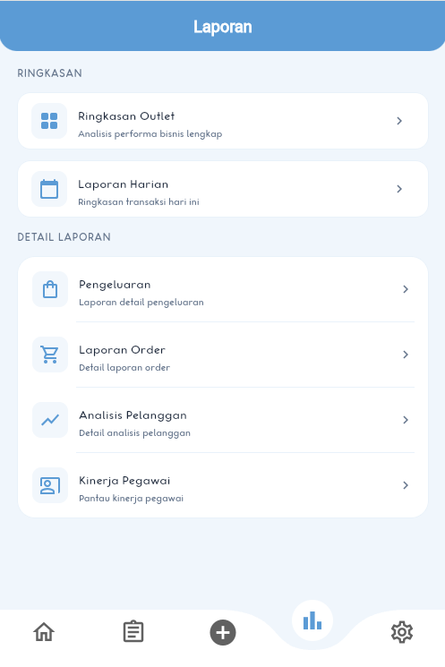
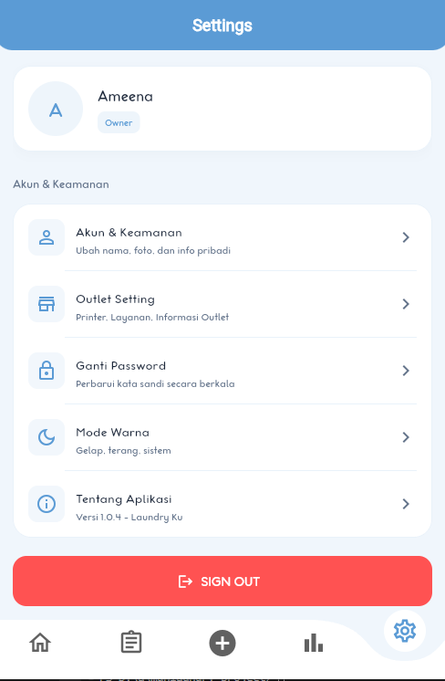

# 🧺 Laundry Ku — Aplikasi Manajemen Laundry Modern

Aplikasi Flutter untuk manajemen laundry yang komprehensif dengan notifikasi real-time, tracking order, dan dashboard terintegrasi. Cocok untuk laundry kecil hingga menengah dengan multiple admin/owner.

## ✨ Fitur Utama

- 📱 **Dashboard Real-time** — Lihat status order, pendapatan harian, dan statistik
- 🔔 **Notifikasi Cerdas** — Notif estimasi selesai, deadline, dan terlambat (sync antar device)
- 📊 **Tracking Order** — Timeline lengkap dari antrian hingga selesai dengan QR code
- 👥 **Multi Admin/Owner** — Support multiple user dengan role berbeda
- 🌙 **Dark Mode** — Interface yang nyaman di mata
- 💾 **Cloud Sync** — Data tersinkronisasi otomatis antar device
- 🔒 **Keamanan Firebase** — Authentication dan database terenkripsi

---

## 🚀 Quick Start

### Prerequisites

- Flutter >= 3.16.0
- Dart >= 3.2.0
- Android Studio atau VS Code
- Git

### 1. Clone Repository

```bash
git clone https://github.com/mdngarage-dev/MdnLaundry.git
cd MdnLaundry
```

### 2. Install Dependencies

```bash
flutter pub get
```

### 3. Setup Firebase

#### A. Buat Project Firebase

1. Buka [Firebase Console](https://console.firebase.google.com)
2. Klik **"New Project"** → Isi nama: `laundry-ku-id`
3. Enable **Firestore Database** (Spark Plan - gratis)
4. Enable **Firebase Auth** (dengan method Email/Password)

#### B. Download Configuration Files

**Untuk Android:**
1. Firebase Console → Project Settings → **General**
2. Di bagian **Your apps**, klik **Android**
3. Isi:
   - Package name: `com.mdngarage.mdnlaundry_project`
   - Signing certificate SHA-1: (jalankan `./gradlew signingReport` di folder Android)
4. Download `google-services.json` → letakkan di `android/app/`

**Untuk iOS (opsional):**
1. Sama seperti Android, download `GoogleService-Info.plist`
2. Letakkan di `ios/Runner/` (perlu Xcode)

### 4. Setup OneSignal (Push Notification)

1. Buka [OneSignal Dashboard](https://onesignal.com)
2. Daftar akun gratis
3. Klik **New App** → Pilih **Google Android (FCM)**
4. Ikuti wizard, upload Firebase Server Key
5. Catat **App ID** dan **REST API Key**

### 5. Setup GitHub Actions (Scheduler)

GitHub Actions menjalankan notifikasi secara otomatis setiap 10 menit (menggantikan Cloud Functions berbayar).

#### A. Siapkan Service Account JSON

1. Firebase Console → Project Settings → **Service Accounts**
2. Klik **Generate New Private Key** → Download file `.json`
3. Buka file, copy **seluruh isinya**

#### B. Setup Secrets di GitHub

1. GitHub repo → **Settings** → **Secrets and variables** → **Actions**
2. Tambah 3 secret:

| Name | Value |
|------|-------|
| `FIREBASE_SERVICE_ACCOUNT` | Isi lengkap file JSON (paste mentah) |
| `ONESIGNAL_APP_ID` | App ID dari OneSignal dashboard |
| `ONESIGNAL_REST_API_KEY` | REST API Key dari OneSignal |

⚠️ **Jangan share/commit file JSON langsung ke repo** — gunakan Secrets saja.

### 6. Build dan Jalankan

#### Build APK (Android)

```bash
flutter build apk --release
```

File APK ada di: `build/app/outputs/flutter-apk/app-release.apk`

#### Run di Emulator/HP

```bash
flutter run
```

---

## 📋 Setup Database Firestore

Struktur Firestore yang perlu dibuat:

```
laundry-ku-id (project)
├── users/
│   └── {userId}/
│       └── notif_history/ (auto-created)
│           └── {notifId}
│               ├── id: string
│               ├── judul: string
│               ├── isi: string
│               ├── waktu: timestamp
│               └── sudahDibaca: boolean
│
├── order/ (collection utama)
│   └── {orderId}
│       ├── nomor_pelanggan: string
│       ├── nama_pelanggan: string
│       ├── no_hp: string
│       ├── status: "antrian" | "proses" | "siap ambil" | "selesai"
│       ├── layanan_nama: string
│       ├── durasi_jam: number
│       ├── harga_total: number
│       ├── waktu_order: timestamp
│       ├── notif_estimasi_terkirim: boolean
│       ├── notif_deadline_terkirim: boolean
│       └── notif_terlambat_terkirim_at: timestamp
│
├── settings/ (untuk konfigurasi outlet)
│   └── {settingsId}
│       ├── nama_outlet: string
│       └── alamat: string
│
└── (koleksi lain sesuai fitur)
```

**Firestore Rules** (keamanan basic):

```javascript
rules_version = '2';
service cloud.firestore {
  match /databases/{database}/documents {
    match /users/{userId}/{document=**} {
      allow read, write: if request.auth.uid == userId;
    }
    match /order/{document=**} {
      allow read, write: if request.auth != null;
    }
  }
}
```

---

## 🔧 Konfigurasi Environment

Jika perlu setup env-specific (dev, staging, prod):

1. Buat file `.env.example`:
```
FIREBASE_PROJECT_ID=laundry-ku-id
ONESIGNAL_APP_ID=54e65963-bfc8-40ad-aef9-cb1d7303590e
API_ENDPOINT=https://api.example.com
```

2. Copy ke `.env` lokal (jangan commit `.env`)

3. Load di `main.dart` atau `lib/config/app_config.dart`

---

## 📁 Struktur Folder

```
lib/
├── main.dart                  # Entry point
├── components/
│   └── notif_laundry.dart    # OneSignal initialization & handlers
├── screens/
│   ├── home_screen.dart      # Dashboard utama
│   ├── order_detail.dart     # Detail order
│   ├── notifikasi.dart       # Halaman riwayat notifikasi (Firestore sync)
│   ├── auth_wrapper.dart     # Auth guard
│   └── ...
├── models/
│   └── (data models)
├── services/
│   └── (business logic)
├── settings/
│   └── (app preferences)
└── themes/
    └── (UI themes)

scripts/
├── notif-scheduler.js        # GitHub Actions scheduler
└── package.json

.github/workflows/
└── notif-scheduler.yml       # GitHub Actions workflow
```

---

## 🔐 Keamanan

### Important Checklist

- ✅ Gunakan GitHub Secrets untuk semua credentials
- ✅ Set Firestore Rules yang ketat (jangan allow all)
- ✅ Enable 2FA di Firebase Console
- ✅ Rotate OneSignal REST API Key secara berkala

### Di Production

- Deploy ke Google Play Store dengan signing key yang aman
- Enable App Integrity API (Play Integrity)
- Setup Firestore backups otomatis
- Monitor Firebase usage untuk mencegah abuse

---

## 🐛 Troubleshooting

### Notif Tidak Masuk

**Cek 1:** HP belum subscribe ke OneSignal
```
OneSignal Dashboard → Audience → Subscriptions
→ Cari device kamu, cek status "Subscribed" atau "Never Subscribed"
```

**Cek 2:** Permission notifikasi belum di-grant
```
HP Settings → Apps → Laundry Ku → Notifications
→ Pastikan toggle "Allow notifications" ON
```

**Cek 3:** GitHub Actions tidak jalan
```
GitHub → Actions → Notif Laundry Scheduler
→ Cek apakah workflow berwarna hijau (success) atau merah (fail)
```

### Order Tidak Muncul

- Pastikan Firestore Database sudah dibuat
- Cek Firestore Rules tidak memblokir akses
- Verify user sudah login dengan akun yang tepat

### Build Error

```bash
# Clean semua cache
flutter clean
rm -rf pubspec.lock
flutter pub get
flutter run
```

### APK Error "No Suitable API"

Update di `android/app/build.gradle`:
```gradle
android {
    compileSdkVersion 34  // Update ke versi terbaru
    ...
}
```

---

## 📚 Tech Stack

- **Frontend:** Flutter, Provider, GetX
- **Backend:** Firebase (Auth, Firestore, Cloud Functions)
- **Push Notification:** OneSignal
- **Scheduler:** GitHub Actions (Node.js)
- **Design:** Material Design 3, Custom themes

---

## 🚀 Deployment

### Development

```bash
flutter run -d <device-id>
```

### Build & Release

```bash
# Build APK
flutter build apk --release

# Build App Bundle (untuk Play Store)
flutter build appbundle --release
```

---


## 📧 Support

Ada pertanyaan? Hubungi:
- Email: [mdngarage.idn@gmail.com]
- WhatsApp: [wa.me/62816829052]

---

## 🎉 Credits

- **Flutter Community** untuk framework keren ini
- **Firebase** untuk backend cloud yang reliable
- **OneSignal** untuk push notification yang mudah digunakan

---

**Made with ❤️ by Laundry Ku Team**



 |  | 

 |  | 

 |  | 